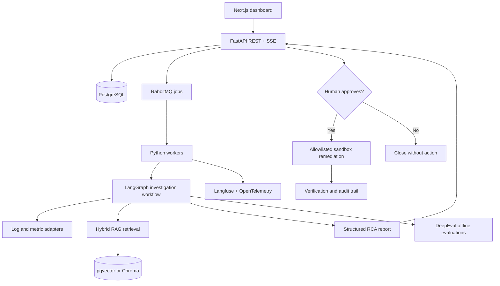

# AI Production Incident Investigator & Remediation Platform

## Project overview
Build an enterprise-style, agentic AI backend that accepts production incidents, gathers relevant evidence, proposes likely root causes, recommends safe remediation, and verifies outcomes after **human approval**. Use synthetic incidents and sandbox services rather than real customer data.

**Portfolio goal:** Demonstrate senior-level Python backend engineering, agent orchestration, RAG, asynchronous processing, observability, evaluation, cloud deployment, and operational reliability.

## Problem statement
Production incidents often require engineers to correlate tickets, application logs, service metrics, deployment history, runbooks, and past incidents. This platform shortens investigation time by collecting evidence and generating traceable recommendations while keeping potentially disruptive actions under human control.

## Core user journey
1. An engineer submits an incident with severity, affected service, timestamps, symptoms, and optional logs.
2. The API validates the request, persists the incident, and enqueues an investigation job.
3. Workers gather logs, recent deployments, related incidents, and relevant runbooks.
4. An agent workflow triages the incident, retrieves evidence, analyzes hypotheses, and produces a structured root-cause report with citations and confidence/uncertainty.
5. The engineer reviews the report and optionally approves a narrowly scoped remediation in a sandbox.
6. The system records the approval, executes an allowlisted action, checks the outcome, and produces an audit trail.

## Proposed architecture

## Main components

### 1. Incident API and dashboard
- Create/list/view incidents, investigations, evidence, reports, and approvals.
- Use Pydantic schemas, authentication, role-based authorization, and PostgreSQL.
- Stream investigation progress through SSE; provide stable status endpoints for reconnects.
- Show agent reasoning summaries, evidence references, and action history without exposing secrets or raw private chain-of-thought.

### 2. Async worker and queue
- RabbitMQ to dispatch investigations; worker processes to execute them.
- Implement retry with exponential backoff, dead-letter queues, idempotency keys, and job state persistence.
- Make duplicate delivery and worker restarts safe.

### 3. LangGraph investigation workflow
- **Triage:** normalize incident details, classify urgency and affected services.
- **Evidence collection:** retrieve logs, deployment changes, metrics, and ticket history from simulated connectors.
- **Knowledge retrieval:** hybrid keyword/vector search over runbooks and previous incidents.
- **RCA:** generate hypotheses with supporting and contradicting evidence.
- **Recommendation:** propose actionable, bounded steps with risk and rollback notes.
- **Approval and verification:** pause before any write operation, require authorized approval, execute only allowlisted sandbox actions, and check results.

### 4. RAG and data
- Ingest Markdown/PDF runbooks, historical incident records, and service documentation.
- Use metadata filters (service, environment, timestamps, tenant), BM25 + vector retrieval, and reranking if justified.
- Cite retrieved evidence in every substantive recommendation.
- Start with PostgreSQL + pgvector or Chroma; choose one and document tradeoffs.

### 5. Evaluation and observability
- Build a labeled synthetic incident dataset with expected evidence and likely causes.
- Track retrieval relevance, groundedness/faithfulness, answer correctness, unsafe-action rate, and human review outcomes with DeepEval plus custom checks.
- Instrument traces, latency, token usage, cost, queue depth, retry counts, and error rates using Langfuse/OpenTelemetry.
- Establish baselines; do not claim accuracy improvements without measurement.

### 6. Security and safeguards
- No unrestricted shell commands or production credentials.
- Enforce tenant/service authorization and redact secrets/PII from logs and traces.
- Treat logs and retrieved documents as untrusted input; test prompt-injection defenses.
- Require explicit human approval for every state-changing remediation, with expiration, scope, audit events, and rollback instructions.

## Suggested stack
| Layer | Technology |
|---|---|
| Backend | Python 3.12+, FastAPI, Pydantic |
| Agent workflow | LangGraph |
| Database | PostgreSQL, SQLAlchemy, Alembic |
| Retrieval | pgvector or Chroma, BM25 |
| Messaging | RabbitMQ |
| UI | Next.js (minimal) |
| Evaluation | DeepEval and custom test cases |
| Observability | Langfuse, OpenTelemetry, Prometheus/Grafana as needed |
| Local development | Docker Compose, pytest, Ruff |
| Delivery | GitHub Actions, Docker, Terraform |
| Cloud | AWS; Kubernetes as a later milestone, not an MVP prerequisite |

## Delivery plan: 12 weeks

### Phase 1 — Working MVP (weeks 1–3)
- Repository setup, schemas, database migrations, incident CRUD, synthetic fixtures.
- Single investigation workflow using mocked log/deployment adapters.
- Basic RAG over runbooks and historical incidents.
- Structured RCA report with evidence links; minimal dashboard.

**Exit criteria:** A user can submit an incident and receive a reproducible, evidence-linked report end to end.

### Phase 2 — Production reliability (weeks 4–6)
- RabbitMQ workers, durable job state, retry/DLQ, idempotency.
- SSE progress, error handling, timeout budgets, rate limits.
- Human approval gate and safe sandbox remediation.
- Unit/integration tests, DeepEval suite, Langfuse traces.

**Exit criteria:** Duplicate jobs, worker crashes, provider timeouts, and denied approvals have tested outcomes.

### Phase 3 — Cloud and DevOps (weeks 7–9)
- Docker Compose and GitHub Actions pipeline.
- Deploy to AWS with least-privilege IAM, secrets handling, and infrastructure as code.
- Add metrics, alerts, backup/recovery notes, and load tests.
- Optionally deploy to Kubernetes once simpler deployment is stable.

**Exit criteria:** A reviewer can follow documented steps to deploy, observe, and troubleshoot the application.

### Phase 4 — Portfolio polish (weeks 10–12)
- Run benchmark scenarios and document quality, latency, and cost.
- Perform failure-injection and security tests.
- Write architecture decision records, API docs, and a clear README.
- Record a short demo showing incident → evidence → recommendation → approval → verification.
- Prepare interview explanations for design tradeoffs.

**Exit criteria:** Public portfolio demonstrates a running system, test evidence, operational considerations, and known limitations.

## Initial backlog (first 10 issues)
1. Scaffold monorepo: `backend/`, `worker/`, `frontend/`, `infra/`, `evals/`, `docs/`.
2. Define `Incident`, `Investigation`, `Evidence`, `Recommendation`, `Approval`, `AuditEvent` models.
3. Add PostgreSQL, migrations, and seed data.
4. Implement incident create/get/list endpoints.
5. Create synthetic logs, runbooks, deployments, and incident examples.
6. Implement evidence adapter interfaces and mock adapters.
7. Build runbook ingestion and retrieval with metadata filtering.
8. Implement LangGraph triage → retrieval → RCA workflow.
9. Return structured report with evidence citations and uncertainty.
10. Add integration test for one complete incident investigation.

## Example demo incident
**Scenario:** Checkout API latency spikes immediately after a deployment.

**Inputs:** A synthetic alert, elevated p95 latency, recent release metadata, error logs, and a runbook describing database connection pool saturation.

**Expected workflow:** Correlate the deployment timestamp and logs; retrieve the relevant runbook; propose connection pool exhaustion as a hypothesis; recommend inspection and rollback options; request approval before a sandbox rollback; verify latency and error-rate changes.

**Important:** The system must distinguish evidence from speculation and must not automatically claim a root cause is proven.

## Non-functional requirements
- Idempotent incident processing and restart-safe workflow state.
- Explicit timeouts, bounded concurrency, and rate limiting.
- Traceability from recommendations to evidence and model/tool calls.
- Access control and secret redaction.
- Reproducible local setup and automated tests.
- Measured p50/p95 latency, cost per investigation, and evaluation results.

## Interview stories to prepare
- Why RabbitMQ instead of Kafka for investigation jobs?
- How are retries and duplicate delivery handled?
- How do you manage 1,000 concurrent investigation requests without 1,000 active LLM calls?
- What happens if the LLM, vector store, or worker fails?
- How do you prevent prompt injection and unsafe tool execution?
- How do you evaluate RCA quality when multiple hypotheses are plausible?
- What would change for multi-tenant enterprise deployment?
- Why did you choose your deployment strategy, and when would Kubernetes become worthwhile?

## Definition of done
- [ ] Complete incident-to-report flow
- [ ] Evidence-backed output with uncertainty
- [ ] Human-approved, sandbox-only remediation
- [ ] Retry, crash, and duplicate-delivery tests
- [ ] Evaluation dataset and reproducible results
- [ ] Observability and audit trail
- [ ] CI/CD and documented deployment
- [ ] Architecture diagram and tradeoff notes
- [ ] Demo video and interview-ready README

## Scope control
Build **one reliable vertical slice first**. Avoid adding multiple agent frameworks, multiple cloud providers, elaborate UI features, or Kubernetes before the core workflow works. Favor measurable correctness and operational reliability over a large number of agents.
